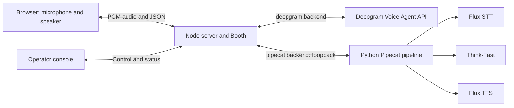

# Architecture and customization

The browser interface and booth lifecycle are shared. `VOICE_BACKEND` chooses
which service implements the voice connection.

## Source map

| Path | Responsibility |
|---|---|
| `agent.config.js` | Prompt, greeting, roles, function schemas, models and closing instructions. |
| `server.js` | Static files, QR generation, browser socket authentication and booth registry. |
| `backend.js` | Backend selection and server-side voice socket creation. |
| `booth.js` | One booth's audio relay, captions, QR tools, interruption and closing state. |
| `pipecat_agent/agent.py` | Private Python service, pipeline, Think-Fast adapter and event translation. |
| `public/` | Shared booth screen, console, audio worklet and browser socket helpers. |
| `test/` | Offline JavaScript tests. |
| `pipecat_agent/test_agent.py` | Offline adapter and pipeline tests. |

## Audio and state

The browser captures PCM16 mono at 16 kHz and plays PCM16 mono at 24 kHz. The
server owns provider connections and credentials. Browser controls never
receive a provider key.

A `Booth` owns one stand connection, multiple console connections and at most
one call. Pipecat implements the subset of the Voice Agent-style socket protocol
that `Booth` uses, so the frontend and closing logic work with either backend.
This is an application adapter, not a general replacement for the Voice Agent API.

Booth IDs select independent in-memory sessions. Restarting the server ends
calls and clears state. Multiple processes do not share a booth registry.

## Add a function

1. Add the function's name, description and JSON parameter schema to `FUNCTIONS`
   in `agent.config.js`.
2. Implement its Voice Agent handler in `Booth.callFunction` in `booth.js`.
3. Register a Pipecat handler in `Conversation.start` in `pipecat_agent/agent.py`.
   Implement the result and decide whether it needs another LLM invocation.
4. Keep parameter types and required fields consistent between the shared schema
   and handlers. The built-in functions have no parameters.
5. Test success, failure and cancellation with fake services. Validate a real
   spoken interaction separately.

Do not execute arbitrary model-supplied URLs or code. Application handlers should
validate arguments and enforce whatever authorization the action needs.

## Closing

Wrap up updates the prompt and injects an operator cue at a quiet moment. The
model says goodbye and calls a tool. `Booth` then waits for outgoing audio to
quiet and for the browser to acknowledge that playback drained, with deadlines
for recovery. End closes immediately. The developer role adds a question about
building an agent before the final goodbye.

Return to the [README](../README.md).
