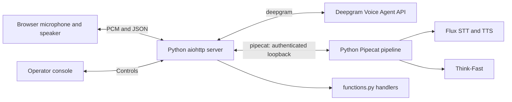

# Architecture and customization

| Path | Responsibility |
|---|---|
| `agent_config.py` | Shared prompt, greeting, models and function schemas. |
| `functions.py` | Async business-function registry and fictional sample lookup. |
| `backend.py` | Voice backend selection and private connection authentication. |
| `server.py` | aiohttp pages, browser sockets, passcode checks and booth registry. |
| `booth.py` | Call lifecycle, audio relay, tools, cancellation, QR and closing. |
| `pipecat_agent/agent.py` | Pipeline, Think-Fast adapter and protocol translation. |
| `public/` | Browser audio, captions and operator interface. |
| `tests/` | Offline server, protocol and lifecycle checks. |
| `pipecat_agent/test_agent.py` | Offline pipeline and LLM adapter checks. |

Both backends use the same Python configuration and business handlers. Add function
schemas to `functions.DEFINITIONS` and async implementations to `functions.HANDLERS`.
The shared Booth validates and dispatches them for both backends. Argument validation
and any authorization or idempotency requirements belong in the handler.

The browser sends 16 kHz PCM16 mono and plays 24 kHz PCM16 mono. Provider keys remain
on the server. The Pipecat sidecar implements the subset of the Voice Agent-style
protocol used by Booth, not a general replacement for the Voice Agent API.

Each booth has one stand and at most one call. Conversation text stays in memory
while active and clears at call end. State is not shared across server processes.
Finish requests one short goodbye and drains playback with a hard deadline;
Stop now closes immediately. Neither flow has a visitor-role selection.
